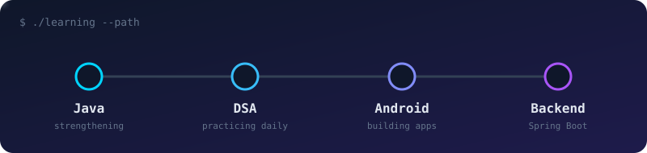

<!-- ========== HEADER ========== -->
<div align="center">


<a href="https://github.com/Nitinmittal373">
  
</a>

<br/>

<a href="https://www.linkedin.com/in/nitinmittal373"></a>
<a href="https://github.com/Nitinmittal373?tab=repositories"></a>


</div>

<br/>

<!-- ========== ABOUT (terminal style) ========== -->
## `~/about`

```java
public class Nitin {
    String role      = "CSE student";
    String[] focus   = {"Java", "DSA", "Android", "Spring Boot"};
    String approach  = "Learn a concept, build something with it, repeat";
    String goal      = "Software engineering internships";

    void today() {
        solveProblems();
        buildProjects();
        keepImproving();
    }
}
```

<br/>

<!-- ========== LEARNING PATH (custom animated SVG) ========== -->
## `~/learning-path`

<div align="center">
  
</div>

<br/>

<!-- ========== STACK ========== -->
## `~/toolbox`

<div align="center">


<br/><br/>

`Room Database` &nbsp;•&nbsp; `RecyclerView` &nbsp;•&nbsp; `Material UI` &nbsp;•&nbsp; `Git/GitHub`

</div>

<br/>

<!-- ========== FEATURED ========== -->
## `~/featured`

<div align="center">
  <a href="https://github.com/Nitinmittal373/ExpenseTracker">
    
  </a>
</div>

<details>
<summary><b>What ExpenseTracker does</b> (click to expand)</summary>
<br/>

- Add, edit and delete expenses
- Category selection
- Total expense calculation
- Persistent local storage with Room
- Empty-state handling
- Material UI

</details>

<br/>

<!-- ========== NOW / NEXT / LATER ========== -->
## `~/roadmap`

| 🟢 Now | 🟡 Next | 🔵 Later |
|:------|:-------|:--------|
| Java + DSA practice | Spring Boot basics | Connect Android app to a backend |
| Android with Java | REST APIs | Machine learning projects |
| Daily problem solving | Better project structure | More polished, documented repos |

<br/>

<!-- ========== STATS ========== -->
## `~/stats`

<div align="center">


<br/>


</div>

<br/>

<!-- ========== SNAKE ========== -->
## `~/contributions`

<div align="center">
  <picture>
    <source media="(prefers-color-scheme: dark)" srcset="https://raw.githubusercontent.com/Nitinmittal373/Nitinmittal373/output/github-snake-dark.svg" />
    <source media="(prefers-color-scheme: light)" srcset="https://raw.githubusercontent.com/Nitinmittal373/Nitinmittal373/output/github-snake.svg" />
    
  </picture>
</div>

<br/>

<!-- ========== FOOTER ========== -->
<div align="center">

<i>Repos are a work in progress, and so am I.</i>


</div>
