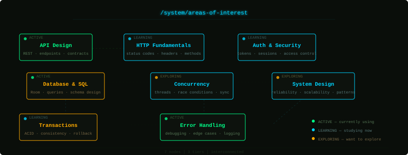

<!-- ╔══════════════════════════════════════════════════════════════════╗ -->
<!-- ║  NODE_01 // NITIN MITTAL — BACKEND CONTROL SYSTEM v3.7.3      ║ -->
<!-- ║  The backend never sleeps.                                     ║ -->
<!-- ╚══════════════════════════════════════════════════════════════════╝ -->

<div align="center">

<picture>
  <source media="(prefers-color-scheme: dark)" srcset="assets/hero-boot.svg" />
  <source media="(prefers-color-scheme: light)" srcset="assets/hero-boot.svg" />
  
</picture>

</div>

<br/>

<!-- ═══════════════ IDENTITY ═══════════════ -->

<div align="center">

```
┌──────────────────────────────────────────────────────────┐
│  NITIN MITTAL                                            │
│  CSE student · Java & DSA · Android · Backend            │
│  ─────────────────────────────────────────────────────    │
│  "I don't just want to make things work.                 │
│   I want to understand why they work."                   │
└──────────────────────────────────────────────────────────┘
```

</div>

I'm a developer who likes looking beneath the surface. APIs, databases, transactions, concurrency, and the little edge cases that turn working code into reliable systems — that's what makes backend engineering interesting to me.

Currently a **CSE student** building projects in **Java** and **Android**, practicing **DSA** daily on NeetCode, and starting to explore **Spring Boot** and backend architecture. Learning by doing, breaking things, then figuring out why they broke.

<br/>

<!-- ═══════════════ SIGNATURE: FAILURE → RECOVERY ═══════════════ -->

<div align="center">

<picture>
  <source media="(prefers-color-scheme: dark)" srcset="assets/failure-recovery.svg" />
  <source media="(prefers-color-scheme: light)" srcset="assets/failure-recovery.svg" />
  
</picture>

<sub><i>Illustrative animation — requests don't always succeed on the first try, and that's where the interesting problems live.</i></sub>

</div>

<br/>

<!-- ═══════════════ AREAS OF INTEREST ═══════════════ -->

<div align="center">

<picture>
  <source media="(prefers-color-scheme: dark)" srcset="assets/interests-map.svg" />
  <source media="(prefers-color-scheme: light)" srcset="assets/interests-map.svg" />
  
</picture>

</div>

<br/>

<!-- ═══════════════ PROJECTS AS SERVICES ═══════════════ -->

## `/system/services`

<table>
<tr>
<td width="50%" valign="top">

```
┌─────────────────────────────────────────┐
│ ● SERVICE: ExpenseTracker               │
│   STATUS:  ACTIVE                       │
│   LANG:    Java                         │
│   STACK:   Android · Room DB ·          │
│            RecyclerView · Material UI   │
├─────────────────────────────────────────┤
│ PURPOSE:                                │
│ Android app for tracking expenses with  │
│ persistent local storage, category      │
│ management, and total calculation.      │
│                                         │
│ BACKEND PROBLEM:                        │
│ Local data persistence, CRUD ops,       │
│ empty-state handling, data consistency  │
│ across views.                           │
└─────────────────────────────────────────┘
```

<div align="center">

[](https://github.com/Nitinmittal373/ExpenseTracker)

</div>

</td>
<td width="50%" valign="top">

```
┌─────────────────────────────────────────┐
│ ● SERVICE: Smart_Contact_Book           │
│   STATUS:  ACTIVE                       │
│   LANG:    Java                         │
│   STACK:   HashMap · Trie · Stack ·     │
│            Queue · TreeMap ·            │
│            PriorityQueue                │
├─────────────────────────────────────────┤
│ PURPOSE:                                │
│ Console contact book where each feature │
│ uses a different data structure.        │
│                                         │
│ BACKEND PROBLEM:                        │
│ Choosing the right data structure for   │
│ each operation — search, sort, undo,    │
│ priority. DSA applied to real logic.    │
└─────────────────────────────────────────┘
```

<div align="center">

[](https://github.com/Nitinmittal373/Smart_Contact_Book)

</div>

</td>
</tr>
<tr>
<td width="50%" valign="top">

```
┌─────────────────────────────────────────┐
│ ● SERVICE: neetcode-submissions         │
│   STATUS:  ACTIVE                       │
│   LANG:    Java                         │
├─────────────────────────────────────────┤
│ PURPOSE:                                │
│ Daily DSA problem solving on NeetCode.  │
│ Arrays, trees, graphs, dynamic          │
│ programming — building the algorithmic  │
│ foundation for backend engineering.     │
│                                         │
│ BACKEND PROBLEM:                        │
│ Algorithmic thinking. Every efficient   │
│ API and every fast query starts with    │
│ the right algorithm underneath.         │
└─────────────────────────────────────────┘
```

<div align="center">

[](https://github.com/Nitinmittal373/neetcode-submissions)

</div>

</td>
<td width="50%" valign="top">

```
┌─────────────────────────────────────────┐
│ ○ SERVICE: HACKATHON_DTU_2026           │
│   STATUS:  EXPERIMENTAL                 │
│   LANG:    JavaScript                   │
├─────────────────────────────────────────┤
│ PURPOSE:                                │
│ Hackathon project built at DTU 2026.    │
│ Fast-paced development under time       │
│ constraints.                            │
│                                         │
│ BACKEND PROBLEM:                        │
│ Building something functional under     │
│ pressure — tradeoffs between speed      │
│ and quality, quick decisions on         │
│ architecture.                           │
└─────────────────────────────────────────┘
```

<div align="center">

[](https://github.com/Nitinmittal373/HACKATHON_DTU_2026)

</div>

</td>
</tr>
<tr>
<td width="50%" valign="top">

```
┌─────────────────────────────────────────┐
│ ○ SERVICE: PERSONAL_FINANCE_TRACKER     │
│   STATUS:  EXPLORING                    │
│   LANG:    Python                       │
├─────────────────────────────────────────┤
│ PURPOSE:                                │
│ Personal finance tracking. Exploring    │
│ Python for data-oriented tooling        │
│ beyond Java.                            │
│                                         │
│ BACKEND PROBLEM:                        │
│ Data modeling for financial records,    │
│ calculations, and persistent storage   │
│ in a different language ecosystem.      │
└─────────────────────────────────────────┘
```

<div align="center">

[](https://github.com/Nitinmittal373/PERSONAL_FINANCE_TRACKER)

</div>

</td>
<td width="50%" valign="top">

```
┌─────────────────────────────────────────┐
│ ○ SERVICE: Fitness-Club-Website         │
│   STATUS:  EXPLORING                    │
│   LANG:    HTML · CSS · JavaScript      │
├─────────────────────────────────────────┤
│ PURPOSE:                                │
│ Frontend web project — understanding    │
│ how the client side works before        │
│ building the server side.               │
│                                         │
│ BACKEND PROBLEM:                        │
│ Understanding the request lifecycle     │
│ from the client's perspective.          │
│ What does the frontend actually need    │
│ from an API?                            │
└─────────────────────────────────────────┘
```

<div align="center">

[](https://github.com/Nitinmittal373/Fitness-Club-Website)

</div>

</td>
</tr>
</table>

<details>
<summary><code>$ ls /system/services --all</code> &nbsp; (other repos)</summary>
<br/>

| Service | Language | Notes |
|---------|----------|-------|
| `BASIC_ML_PROJECT` | Jupyter Notebook | Exploring ML fundamentals |
| `NUMPY` | Jupyter Notebook | Learning NumPy for data work |
| `PANDAS` | Jupyter Notebook | Learning Pandas for data manipulation |
| `SLOT_MACHINE` | Python | Small Python project |
| `PYTHON-TASK` | Python | Python practice |
| `DEMO` | HTML | Learning & experimentation |

</details>

<br/>

<!-- ═══════════════ TECH STACK ═══════════════ -->

## `/system/stack`

```
 ┌───────────── CURRENTLY USING ─────────────┐   ┌────────── LEARNING ──────────┐
 │                                            │   │                              │
 │  Java ███████████████████████████  primary  │   │  Spring Boot  ░░░░░░░░░░░░  │
 │  Android (Java) ████████████████  building  │   │  REST APIs    ░░░░░░░░░░░░  │
 │  Room Database ██████████████     local DB   │   │  System Design ░░░░░░░░░░  │
 │  Git / GitHub ██████████████      daily     │   │  ML basics    ░░░░░░░░░░░░  │
 │  Python ████████████              scripting │   │                              │
 │  HTML / CSS / JS ███████████      basics    │   └──────────────────────────────┘
 │                                            │
 └────────────────────────────────────────────┘
```

<br/>

<!-- ═══════════════ WHOAMI ═══════════════ -->

<div align="center">

<picture>
  <source media="(prefers-color-scheme: dark)" srcset="assets/whoami.svg" />
  <source media="(prefers-color-scheme: light)" srcset="assets/whoami.svg" />
  
</picture>

</div>

<br/>

<!-- ═══════════════ GITHUB STATS ═══════════════ -->

## `/system/metrics`

<div align="center">


&nbsp;


<br/>


</div>

<br/>

<!-- ═══════════════ CONNECT ═══════════════ -->

## `/system/connect`

<div align="center">

[](https://github.com/Nitinmittal373)
&nbsp;&nbsp;
[](https://www.linkedin.com/in/nitinmittal373)

</div>

<br/>

<!-- ═══════════════ FOOTER ═══════════════ -->

<div align="center">

<picture>
  <source media="(prefers-color-scheme: dark)" srcset="assets/footer.svg" />
  <source media="(prefers-color-scheme: light)" srcset="assets/footer.svg" />
  
</picture>

</div>

<!-- ╔══════════════════════════════════════════════════════════════════╗ -->
<!-- ║  END OF TRANSMISSION                                           ║ -->
<!-- ║  NODE_01 — Repos are a work in progress, and so am I.          ║ -->
<!-- ╚══════════════════════════════════════════════════════════════════╝ -->
